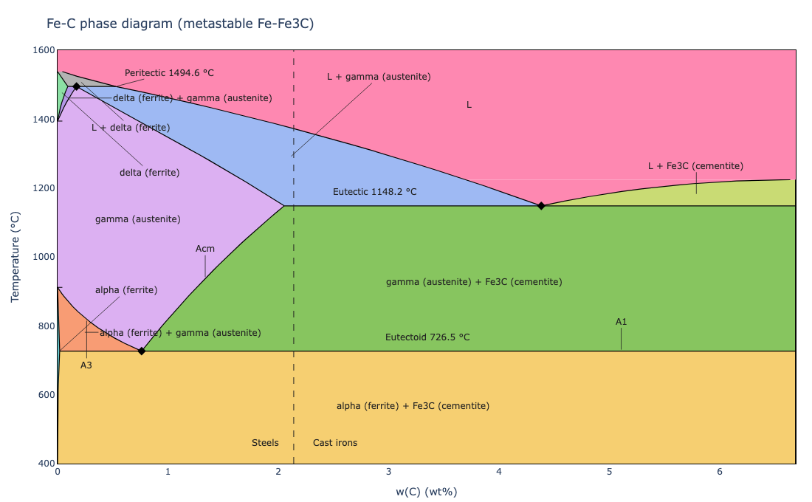

# Phase Diagram Explorer

[](https://phase-diagram-explorer.streamlit.app/)
[](https://github.com/sachinkumarage/phase-diagram-explorer/actions/workflows/tests.yml)
[](LICENSE)

Phase Diagram Explorer computes binary temperature-composition phase diagrams at 1 atm from assessed CALPHAD thermodynamic databases. From the Gibbs energy of every phase, it finds the equilibrium phases, their compositions and fractions at any temperature and composition, traces the phase boundaries from exact common tangents, and locates invariant reactions (eutectic, eutectoid, peritectic) by root-finding, so that no result depends on a composition grid. Results are validated in three ways: against pycalphad reading the same database files (invariant temperatures within 0.01 K, compositions within 1e-4 in mole fraction), against the database authors' own published calculations, and against experimental and textbook values. The validated systems are Ag-Cu and Pb-Sn (NIST solder database) and Fe-C (Hallstedt et al. 2010), the last as both the metastable Fe-Fe3C and the stable Fe-graphite diagram. An interactive web app and a command-line interface present the results, with vector (SVG, PDF) figure export and full-precision CSV data.



*The metastable Fe-Fe3C diagram as shown in the app: textbook phase names, the A1, A3 and Acm lines, the steel / cast iron division at 2.14 wt% C, and invariant temperatures from the assessed database.*

## Validation

Key invariant reactions computed by this engine, by pycalphad 0.11.2 on the same database file, the database reference values, and experimental or textbook values. Temperatures in °C, compositions of the eutectic or eutectoid liquid or austenite in wt% of the second element (mole fraction for Ag-Cu). Full tables, tolerances and overlay plots: [docs/validation/](docs/validation/).

| System | Reaction | Quantity | This engine | pycalphad | Database reference | Experiment / literature |
|---|---|---|---|---|---|---|
| Ag-Cu | L → (Ag) + (Cu) | T (°C) | 779.13 | 779.12 | 779.1 (NIST) | 779 ± 3 [1] |
| | | liquid x(Cu) | 0.40254 | — | 0.40250 (NIST) | 0.399 ± 0.010 [1] |
| Pb-Sn | L → (Pb) + (Sn) | T (°C) | 182.24 | 182.24 | 182.2 (NIST) | 183 ± 2 [2] |
| | | liquid wt% Sn | 62.13 | — | 62.13 (NIST) | 61.9 ± 1.5 [2] |
| Fe-C, metastable | γ → α + Fe3C (eutectoid) | T (°C) | 726.53 | 726.53 | 726.53 | 727 ± 2 [3] |
| | | γ wt% C | 0.7617 | 0.7616 | 0.7617 | 0.76 ± 0.03 [3] |
| | L → γ + Fe3C (eutectic) | T (°C) | 1148.16 | 1148.16 | 1148.16 | 1147 ± 2 [3] |
| | | L wt% C | 4.3834 | 4.3836 | 4.3834 | 4.30 ± 0.10 [3] |
| | δ + L → γ (peritectic) | T (°C) | 1494.61 | 1494.62 | 1494.61 | 1495 ± 2 [3] |
| Fe-C, stable | γ → α + graphite | T (°C) | 738.02 | 738.02 | 738.02 | 738 ± 2 [3] |
| | L → γ + graphite | T (°C) | 1153.43 | 1153.44 | 1153.43 | 1153 ± 2 [3] |

- **Database reference.** For Ag-Cu and Pb-Sn, NIST's published calculation from the same database (converted from mass % with the database's molar masses). For Fe-C, the values recorded when the system was added, when this engine and pycalphad agreed to 0.002 K and 4e-5 in mole fraction; the tests hold them to 0.05 K and 0.0005 wt% to catch regressions.
- **Experiment / literature.** [1] Subramanian and Perepezko, J. Phase Equilib. 14 (1993) 62-75. [2] Commonly reported values for the Pb-Sn eutectic; the repository does not record a single source for them. [3] Textbook and compilation values; the tolerances cover the spread between published assessments and are justified in `tests/test_fe_c.py`.
- **pycalphad.** The invariant temperature is where the reacting phase appears or disappears inside the reaction line, bisected to 0.001-0.002 K. "—": for Ag-Cu and Pb-Sn the comparison covers the solid phases only (see the system pages).
- **Engine against pycalphad, more broadly.** Synthetic fixtures (interstitial, magnetic, miscibility gap) and pycalphad's own literature test databases (Pb-Sn, Cu-Mg, Fe-C) agree in Gibbs energies at the same site fractions (within 1e-6 J/mol), stable phases, fractions and compositions at 30 points per system (within 1e-3), and invariant temperatures (within 0.5 K, in practice 0.005 K): [docs/validation/engine_vs_pycalphad.md](docs/validation/engine_vs_pycalphad.md).

## Method

The thermodynamic models and algorithms are described in [docs/theory.md](docs/theory.md).

- **Gibbs energy models.** Every phase is described by the Compound Energy Formalism (sublattice model): a reference surface of end-member Gibbs energies, ideal configurational entropy weighted by the site ratios, and excess terms as Redlich-Kister series of interaction parameters. Substitutional and interstitial solutions, ordered phases with internal degrees of freedom, stoichiometric compounds and pure elements are special cases. Magnetic contributions use the Inden-Hillert-Jarl model. Unary data follow the SGTE description (Dinsdale 1991) as given in each database; TDB files are read directly.
- **Composition per mole of atoms.** For each phase, G(x) is the minimum of the molar Gibbs energy over the site fractions consistent with the composition: in closed form when one sublattice mixes two species, otherwise by constrained minimisation with analytic gradients. dG/dx comes from the Lagrange multiplier of the composition constraint.
- **Equilibrium.** At fixed temperature, the lower convex hull of all phases' Gibbs energy curves identifies the stable phase fields. Each tie line is then refined to the exact common tangent from analytic derivatives, checked against every other phase, and split if a phase lies below it. Miscibility gaps are detected as tie lines between two composition sets of one phase that bridge a part of its curve lying above the tangent. Phase fractions follow from the lever rule.
- **Boundary tracing.** Phase fields are traced over temperature from these tie lines. Temperature levels are chosen adaptively: each change of field structure is bracketed to 1e-3 K by bisection, and intervals are subdivided where a boundary moves or bends. Drawn boundaries are exact equilibrium compositions at every level.
- **Invariant reactions.** Candidate reactions come from changes in the phase assemblage between temperature levels; each is refined by root-finding (Brent's method) on the three-phase condition, that the reacting phase just touches the common tangent of the other two, to 1e-6 K. All three phase compositions are reported.

## Data sources and licensing

Thermodynamic databases are **downloaded from their official locations and verified by SHA256**, never redistributed: `data/tdb/` is git-ignored, and `data/sources.json` registers each file's URL, size, SHA256 and license. `python scripts/fetch_tdb.py` downloads and verifies them; the app and `load_system` also fetch a missing file on first use. A failed download or a file that does not match is an error; there is no fallback to other data. The files are not redistributed because their publishers distribute them under their own terms (NIST), or because the file carries no license text of its own (the pycalphad test database); fetching from the original source keeps attribution and terms with the data.

**NIST solder database** (Ag-Cu and Pb-Sn), downloaded from https://www.metallurgy.nist.gov/phase/solder/NIST-solder.tdb. License: https://www.nist.gov/open/license.

- Kattner, U.R. (2017), Phase Diagrams & Computational Thermodynamics - Solder Systems, NIST Standard Reference Database 139, National Institute of Standards and Technology, https://doi.org/10.18434/T4759N (Accessed 12 October 2026).
- Ag-Cu: F.H. Hayes, H.L. Lukas, G. Effenberg, G. Petzow, Z. Metallkd. 77 (1986) 749-754.
- Pb-Sn: H.J. Fecht, M.-X. Zhang, Y.A. Chang, J.H. Perepezko, Metall. Trans. A 20A (1989) 795-803. NIST Pb-Sn page: https://www.metallurgy.nist.gov/phase/solder/pbsn.html
- Unary data: A.T. Dinsdale, CALPHAD 15 (1991) 317-425.

**Fe-C**: pycalphad's test database `cfe_broshe.tdb`, fetched from the pycalphad repository at the 0.11.2 release tag (https://raw.githubusercontent.com/pycalphad/pycalphad/0.11.2/pycalphad/tests/databases/cfe_broshe.tdb). The file carries no license text of its own; the pycalphad repository is MIT-licensed.

- B. Hallstedt, D. Djurovic, J. von Appen, R. Dronskowski, A. Dick, F. Koermann, T. Hickel, J. Neugebauer, Calphad 34 (2010) 129-133.
- A.T. Dinsdale, CALPHAD 15 (1991) 317-425.
- Brosh et al., CALPHAD 31 (2007) 173-185 (equation of state; not used at 1 atm beyond its contribution at that pressure).
- Database file: pycalphad 0.11.2 test database cfe_broshe.tdb.

The app shows each system's citations below its diagram. pycalphad's other test databases (Pb-Sn of Ngai and Chang 1981, Cu-Mg, Fe-C) are used only by the cross-validation tests, from the local pycalphad installation.

## Limitations

- **Binary systems only.** A multicomponent database is read through one of its binary subsystems (e.g. Ag-Cu-Va from the six-element NIST file).
- **Fixed pressure.** All results are at 1 atm (101325 Pa). Pressure-dependent descriptions are evaluated at that pressure.
- **Models not supported.** Order-disorder descriptions with a disordered part (`DIS_PART` type definitions, e.g. B2/BCC) and non-element species as constituents raise `NotImplementedError` rather than being silently dropped. Reciprocal and ternary interaction parameters are supported at order 0 only.
- **Fe-C phases suspended.** Two phases of `cfe_broshe.tdb` are left out:
  - M7C3_D101 (Fe7C3): its parameters are attributed only to an unidentified "This work" in the file. It is never stable below x(C) = 0.25, so leaving it out does not change the displayed diagram; a test checks this to 1e-8.
  - DIAMOND_A4: stable only at high pressure. With graphite suspended (the metastable diagram), ferrite + diamond would replace ferrite + Fe3C below 589 °C, so it must stay out.
  - The metastable diagram additionally suspends GRAPHITE, by definition. Fe-C is shown from 0 to 6.69 wt% C (Fe3C) and 400 to 1600 °C.
- **Detection limits.** A field that appears and disappears between two scan levels (5 K apart for invariant detection) is not found, and a miscibility gap narrower than the Gibbs-curve sampling step is missed; in practice this matters only within about 0.02 K of a critical temperature. Between adaptive levels, boundaries are drawn as straight segments.
- **Validated scope.** Only Ag-Cu, Pb-Sn and Fe-C are validated against assessed data. Other TDB files load and compute, but their results carry no validation beyond the engine checks above.

## How to cite

If you use Phase Diagram Explorer in your work, please cite the software as described in [CITATION.cff](CITATION.cff) (GitHub shows a "Cite this repository" button), and cite the thermodynamic assessments and databases listed above for the systems you use.

## Running the web app

The app is deployed on Streamlit Community Cloud: https://phase-diagram-explorer.streamlit.app/

```
pip install -r requirements.txt     # the package plus its pinned runtime dependencies
streamlit run streamlit_app.py
```

- Select a system (Ag-Cu, Fe-C, Pb-Sn), a temperature range and a composition, and see the stable phases, phase fractions (mole fractions in at%, mass fractions in wt%), phase compositions, the lever-rule calculation and the Gibbs energy curves with the common tangent, always plotted against mole fraction, where the common tangent construction is valid.
- Fe-C has two diagrams, chosen with "Diagram": "Metastable Fe-Fe3C (steel practice)" (the default) and "Stable Fe-graphite".
- Phase fields carry textbook names (e.g. L, (Ag), gamma (austenite)); the legend, tables and hover text also give the CALPHAD names.
- Export the diagram as SVG or PDF, and the equilibrium and invariant reactions as CSV at full precision.
- At the default settings the diagram, invariants and point equilibria come from `data/precomputed/` (one file per diagram mode for Fe-C), so the app starts quickly and keeps working if a database cannot be downloaded; only the Gibbs energy curves need the database. Other settings are computed live.

`streamlit_app.py` is the entry point used by Streamlit Community Cloud; settings are in `.streamlit/config.toml`. Visitors see a short message instead of a traceback if something fails.

### Regenerating precomputed data

```
python scripts/precompute.py            # writes data/precomputed/<system>[.<mode>].npz
python scripts/precompute.py --check    # exit status 1 if any file is missing or out of date
```

Each file records the SHA256 of its source data, the package version, the gas constant, the temperature range and the settings; the app uses a file only while these match, and a test fails if any file is missing or stale. Every engine change bumps the package version, which makes the files stale.

Runtime dependencies go into both `pyproject.toml` and `requirements.txt`. Development and validation tools (`pytest`, `pycalphad`) never go into `requirements.txt`.

## Command line

```
phase-diagram-explorer plot --system ag_cu                    # writes ag_cu_phase_diagram.svg
phase-diagram-explorer plot --system ag_cu --output ag_cu.pdf --unit C
phase-diagram-explorer export-tdb --system ag_cu --output ag_cu.tdb   # also writes ag_cu.meta.json
phase-diagram-explorer list
```

`--system` is a name in `data/systems/` (or `$PHASE_DIAGRAM_SYSTEMS_DIR`) or a path to a `.json` or `.tdb` file. `python -m phase_diagram_explorer` works the same way.

## Data formats and API

Systems are JSON files or TDB databases with a `.meta.json` that gives the element order, display settings and, for downloaded databases, the registered source. See [docs/data_format.md](docs/data_format.md).

```python
from phase_diagram_explorer.models import load_system
from phase_diagram_explorer.builder import build_system
from phase_diagram_explorer.equilibrium.equilibrium import compute_equilibrium

definition = load_system("data/systems/fe_c.meta.json")             # fetches the database if missing
system = build_system(definition.in_mode("metastable"))              # Fe-Fe3C: graphite suspended
result = compute_equilibrium(system, 1000.0, 0.03)                   # T in K, x = mole fraction of C
print(result.stable_phases, result.phase_fractions, result.phase_compositions)

definition = load_system("data/tdb/nist_solder.tdb", elements=["AG", "CU"])  # a binary subsystem
definition = load_system("my_system.tdb", elements=["Fe", "C"], gas_constant=8.3145)  # R defaults to 8.31451
```

## Running the tests

Install the test runner with `pip install -e ".[dev]"`. Three markers are skipped by default, so a plain local run is fast:

- `slow`: full-range tracing, precomputed-data, export and headless Streamlit app tests;
- `validation`: the pycalphad cross-validation tests (`pip install -e ".[dev,validation]"`);
- `network`: real downloads from the official database URLs.

```
pytest            # same as: pytest -m "not slow and not validation and not network"
pytest -m ""      # everything
```

Any warning raised from this package's own code fails the suite. CI runs the full suite on Python 3.11 and 3.12 after fetching the databases and checking the precomputed data, runs the validation tests in a separate job, and runs an app smoke test in a fresh environment installed only from `requirements.txt`, once with the databases unavailable and once with them downloaded.

Regenerate the validation reports with `python -m phase_diagram_explorer.validation` (engine vs pycalphad, Ag-Cu, Pb-Sn) and `python -m phase_diagram_explorer.fe_c` (Fe-C).

## License

MIT; see [LICENSE](LICENSE). The thermodynamic databases are not part of this repository and remain under their own terms (see "Data sources and licensing").
