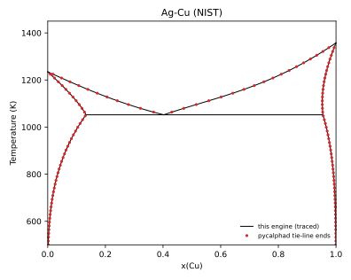

# Ag-Cu: assessed system vs NIST and experiment

Generated by `python -m phase_diagram_explorer.validation --systems` with phase-diagram-explorer 1.0.0 and pycalphad 0.11.2. The tests in `tests/test_ag_cu_assessed.py` and `tests/validation/` check these values.

**Data.** The Ag-Cu subsystem of the NIST solder database, downloaded from NIST (`scripts/fetch_tdb.py`, verified by SHA256) and not redistributed here:

- Kattner, U.R. (2017), Phase Diagrams & Computational Thermodynamics - Solder Systems, NIST Standard Reference Database 139, National Institute of Standards and Technology, https://doi.org/10.18434/T4759N (Accessed 12 October 2026).
- F.H. Hayes, H.L. Lukas, G. Effenberg, G. Petzow, Z. Metallkd. 77 (1986) 749-754.
- A.T. Dinsdale, CALPHAD 15 (1991) 317-425.

Gas constant here: 8.31451 J/(mol K); pycalphad uses 8.3145.

## Eutectic L -> FCC_A1#1 + FCC_A1#2

NIST's calculated values (https://www.metallurgy.nist.gov/phase/solder/agcu.html) are 779.1 °C and 28.41, 8.27 and 92.53 mass % Cu. They are converted with x(Cu) = (w/63.546) / (w/63.546 + (100 - w)/107.87), the database's molar masses, and 779.1 °C = 1052.25 K.

| Quantity | This engine | NIST (same database) | Difference | Experiment | Difference | pycalphad |
|---|---|---|---|---|---|---|
| Eutectic T (K) | 1052.276 | 1052.250 | +0.026 | 1052.0 ± 3.0 | +0.276 | 1052.272 |
| FCC_A1#1 x(Cu) | 0.13274 | 0.13273 | +0.00001 | 0.141 ± 0.015 | -0.00826 | 0.13273 |
| Liquid x(Cu) | 0.40254 | 0.40250 | +0.00004 | 0.399 ± 0.01 | +0.00354 | - |
| FCC_A1#2 x(Cu) | 0.95460 | 0.95460 | -0.00000 | 0.95 ± 0.01 | +0.00460 | 0.95460 |

Test tolerances: against NIST ±0.2 K and ±0.0005 in mole fraction; against experiment as listed. The pycalphad temperature is where LIQUID appears on heating at x(Cu) = 0.4 (bisected to 0.001 K); its solid compositions are 0.01 K below that.

## Melting points

| Element | This engine (LIQUID = solid) | Experiment | Difference |
|---|---|---|---|
| Ag (FCC_A1) | 1234.930 K | 1234.93 ± 0.1 K | -0.000 K |
| Cu (FCC_A1) | 1357.770 K | 1357.77 ± 0.1 K | -0.000 K |

Melting detected from equilibria at x = 1e-9 and 1 - 1e-9 agrees with these crossings to within 0.05 K.

## Phase boundaries

Lines: boundaries traced by this engine. Points: two-phase tie-line end points from pycalphad equilibria on the same file (60 x 201 grid).

