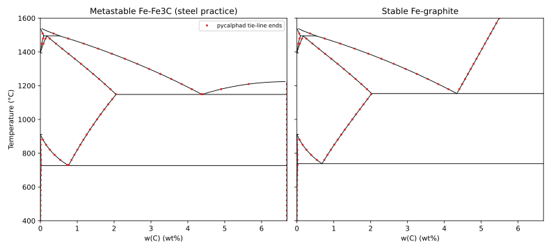

# Fe-C: assessed system vs pycalphad and literature

Generated by `python -m phase_diagram_explorer.fe_c` with phase-diagram-explorer 0.4.0 and pycalphad 0.11.2. The tests in `tests/test_fe_c.py` and `tests/validation/test_fe_c_vs_pycalphad.py` check these values.

**Data.** pycalphad's test database `cfe_broshe.tdb` (release 0.11.2), fetched from the pycalphad repository (`scripts/fetch_tdb.py`, verified by SHA256) and not redistributed here. The file carries no license text of its own; the pycalphad repository is MIT-licensed.

- B. Hallstedt, D. Djurovic, J. von Appen, R. Dronskowski, A. Dick, F. Koermann, T. Hickel, J. Neugebauer, Calphad 34 (2010) 129-133.
- A.T. Dinsdale, CALPHAD 15 (1991) 317-425.
- Brosh et al., CALPHAD 31 (2007) 173-185 (equation of state; not used at 1 atm beyond its contribution at that pressure).
- Database file: pycalphad 0.11.2 test database cfe_broshe.tdb.

**Phases left out** (in both modes):

- M7C3_D101: Left out: its parameters are attributed only to an unidentified "This work" (REF1) in the database file. It is never stable below x(C) = 0.25, so leaving it out does not change the displayed diagram.
- DIAMOND_A4: Left out: diamond is stable only at high pressure. At 1 atm it is always less stable than graphite, so it never appears in the stable diagram; with graphite suspended (the metastable Fe-Fe3C diagram) ferrite + diamond would replace ferrite + Fe3C below 589 °C, which is not the Fe-Fe3C diagram of steel practice.

**Modes.** Metastable Fe-Fe3C (steel practice): GRAPHITE suspended. Stable Fe-graphite: GRAPHITE included (cementite stays in the system but is never stable). The diagram is shown for x(C) = 0 to 0.25 (0 to 6.69 wt% C, Fe3C).

Compositions: w = 100 x M_C / (x M_C + (1 - x) M_Fe), with the database's M_Fe = 55.847 and M_C = 12.011 g/mol. Temperatures: °C = K - 273.15.

## Metastable Fe-Fe3C (steel practice)

| Reaction | Quantity | This engine | pycalphad | Database reference | Literature |
|---|---|---|---|---|---|
| eutectoid (BCC_A2 + FCC_A1 + CEMENTITE_D011) | T (°C) | 726.532 | 726.533 | 726.53 ± 0.05 | 727 ± 2 |
| | BCC_A2 wt% C (x) | 0.0191 (0.000885) | 0.0190 (0.000885) | 0.0191 ± 0.0005 | 0.022 ± 0.004 |
| | FCC_A1 wt% C (x) | 0.7617 (0.034458) | 0.7616 (0.034452) | 0.7617 ± 0.0005 | 0.76 ± 0.03 |
| | CEMENTITE_D011 wt% C (x) | 6.6894 (0.250000) | 6.6894 (0.250000) | - | - |
| eutectic (FCC_A1 + LIQUID + CEMENTITE_D011) | T (°C) | 1148.160 | 1148.161 | 1148.16 ± 0.05 | 1147 ± 2 |
| | FCC_A1 wt% C (x) | 2.0541 (0.088849) | 2.0539 (0.088839) | 2.0541 ± 0.0005 | 2.14 ± 0.12 |
| | LIQUID wt% C (x) | 4.3834 (0.175706) | 4.3836 (0.175711) | 4.3834 ± 0.0005 | 4.3 ± 0.1 |
| | CEMENTITE_D011 wt% C (x) | 6.6894 (0.250000) | 6.6894 (0.250000) | - | - |
| peritectic (BCC_A2 + FCC_A1 + LIQUID) | T (°C) | 1494.614 | 1494.615 | 1494.61 ± 0.05 | 1495 ± 2 |
| | BCC_A2 wt% C (x) | 0.0929 (0.004307) | 0.0929 (0.004304) | - | - |
| | FCC_A1 wt% C (x) | 0.1717 (0.007934) | 0.1718 (0.007938) | - | - |
| | LIQUID wt% C (x) | 0.5275 (0.024066) | 0.5283 (0.024099) | - | - |

## Stable Fe-graphite

| Reaction | Quantity | This engine | pycalphad | Database reference | Literature |
|---|---|---|---|---|---|
| eutectoid (BCC_A2 + FCC_A1 + GRAPHITE) | T (°C) | 738.022 | 738.023 | 738.02 ± 0.05 | 738 ± 2 |
| | BCC_A2 wt% C (x) | 0.0179 (0.000832) | 0.0179 (0.000832) | - | - |
| | FCC_A1 wt% C (x) | 0.6813 (0.030910) | 0.6812 (0.030906) | - | - |
| eutectic (FCC_A1 + LIQUID + GRAPHITE) | T (°C) | 1153.434 | 1153.435 | 1153.43 ± 0.05 | 1153 ± 2 |
| | FCC_A1 wt% C (x) | 2.0285 (0.087818) | 2.0283 (0.087808) | - | - |
| | LIQUID wt% C (x) | 4.3379 (0.174129) | 4.3377 (0.174124) | - | - |
| peritectic (BCC_A2 + FCC_A1 + LIQUID) | T (°C) | 1494.614 | 1494.615 | 1494.61 ± 0.05 | - |
| | BCC_A2 wt% C (x) | 0.0929 (0.004307) | 0.0929 (0.004304) | - | - |
| | FCC_A1 wt% C (x) | 0.1717 (0.007934) | 0.1718 (0.007938) | - | - |
| | LIQUID wt% C (x) | 0.5275 (0.024066) | 0.5283 (0.024099) | - | - |

Tolerances in the tests: this engine vs pycalphad 0.01 K and 1e-4 in mole fraction; vs the database reference values 0.05 K and 0.0005 wt%; vs literature as listed (the spread between published assessments and compilations). pycalphad's temperature is where the reaction's middle phase appears or disappears inside the reaction line (bisected to 0.002 K); its compositions are from tie lines 0.05 K away.

Leaving out M7C3_D101 changes nothing below x(C) = 0.25: with it, the metastable system has one more invariant, Fe3C + L + M7C3 at 1210.7 °C and 7.7-8.4 wt% C, beyond Fe3C (checked in `tests/test_fe_c.py`).

## Phase boundaries

Lines: boundaries traced by this engine. Points: two-phase tie-line end points from pycalphad equilibria on the same file (41 temperatures x 126 compositions per mode).

