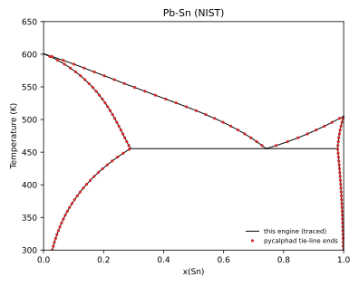

# Pb-Sn: assessed system vs NIST and experiment

Generated by `python -m phase_diagram_explorer.validation --systems` with phase-diagram-explorer 0.3.1 and pycalphad 0.11.2. The tests in `tests/test_pb_sn_assessed.py` and `tests/validation/` check these values.

**Data.** The Pb-Sn subsystem of the NIST solder database, downloaded from NIST (`scripts/fetch_tdb.py`, verified by SHA256) and not redistributed here:

- Kattner, U.R. (2017), Phase Diagrams & Computational Thermodynamics - Solder Systems, NIST Standard Reference Database 139, National Institute of Standards and Technology, https://doi.org/10.18434/T4759N (Accessed 12 October 2026).
- H.J. Fecht, M.-X. Zhang, Y.A. Chang, J.H. Perepezko, Metall. Trans. A 20A (1989) 795-803.
- A.T. Dinsdale, CALPHAD 15 (1991) 317-425.
- NIST Pb-Sn page: https://www.metallurgy.nist.gov/phase/solder/pbsn.html

Gas constant here: 8.31451 J/(mol K); pycalphad uses 8.3145.

## Eutectic L -> FCC_A1 + BCT_A5

NIST's calculated values (https://www.metallurgy.nist.gov/phase/solder/pbsn.html) are 182.2 °C and 62.13, 18.91 and 96.59 mass % Sn. They are converted with x(Sn) = (w/118.69) / (w/118.69 + (100 - w)/207.2), the database's molar masses, and 182.2 °C = 455.35 K.

| Quantity | This engine | NIST (same database) | Difference | Experiment | Difference | pycalphad |
|---|---|---|---|---|---|---|
| Eutectic T (K) | 455.391 | 455.350 | +0.041 | 456.15 ± 2.0 | -0.759 | 455.392 |
| FCC_A1 x(Sn) | 0.28929 (18.91 wt%) | 0.28932 | -0.00003 | 0.29052 | -0.00123 | 0.28926 |
| Liquid x(Sn) | 0.74119 (62.13 wt%) | 0.74120 | -0.00001 | 0.73933 | +0.00186 | - |
| BCT_A5 x(Sn) | 0.98021 (96.59 wt%) | 0.98018 | +0.00003 | 0.98552 | -0.00531 | 0.98021 |

Test tolerances: against NIST ±0.2 K and ±0.0005 in mole fraction; against experiment as listed. The pycalphad temperature is where LIQUID appears on heating at x(Sn) = 0.5 (bisected to 0.001 K); its solid compositions are 0.01 K below that.

Experimental compositions are given in mass %: eutectic liquid 61.9 ± 1.5 wt% Sn, maximum Sn in (Pb) about 19 ± 2 wt%, maximum Pb in (Sn) about 2.5 ± 1.5 wt% (183 ± 2 °C). The mole fractions listed are those central values converted; the tests compare in mass %.

## Melting points

| Element | This engine (LIQUID = solid) | Experiment | Difference |
|---|---|---|---|
| Pb (FCC_A1) | 600.612 K | 600.61 ± 0.1 K | +0.002 K |
| Sn (BCT_A5) | 505.078 K | 505.08 ± 0.1 K | -0.002 K |

Melting detected from equilibria at x = 1e-9 and 1 - 1e-9 agrees with these crossings to within 0.05 K.

## Phase boundaries

Lines: boundaries traced by this engine. Points: two-phase tie-line end points from pycalphad equilibria on the same file (60 x 201 grid).

